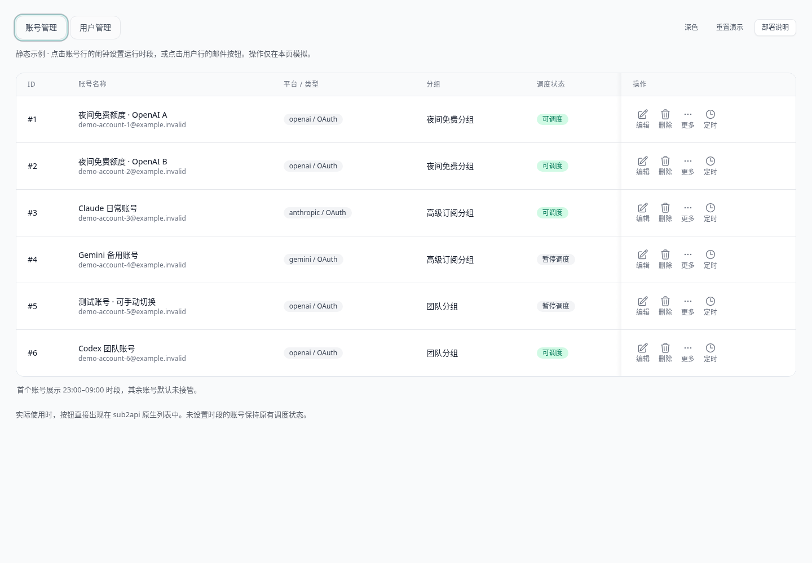

# sub2api Helper

为 [Wei-Shaw/sub2api](https://github.com/Wei-Shaw/sub2api) 原生管理列表增加邮件和定时调度按钮，复用原页面的按钮、输入框、配色和明暗主题，不增加 Helper header 或侧栏。Helper 版本始终与官方正式 Release 对齐，当前版本见 [helper/VERSION](helper/VERSION)，精确适配基线见 [upstream-baseline.json](docs/upstream-baseline.json)。

## 功能

[GitHub Pages 界面演示](https://aaronyang0628.github.io/sub2api-helper/) 使用示例用户和账号展示原生列表里的邮件、闹钟操作，不连接真实服务，不发送邮件、不充值。见 [演示说明](docs/pages.md)。实际功能请部署后端镜像。



- **账号定时调度**：账号管理列表每行增加闹钟按钮，只给特殊账号设置时段、星期和 IANA 时区，支持 `23:00 → 次日 09:00`。未配置的账号不创建计划，也不修改当前状态；显式保存“全天”才启用调度并移除该行的定时计划。窗口内设为可调度，窗口外关闭，不改变账号本身的启用状态。每 30 秒核对，重启后恢复。跨午夜窗口归属于开始日，例如周五 23 点至周六 9 点属于周五。
- **用户维护**：用户列表每行增加邮件按钮，点击后直接填写主题和正文。收件地址从上游重新读取。高级设置支持闲置邮件规则，按 `last_used_at`（模型实际使用时间）判断；邮件被 SMTP 接受后才能禁用，禁用前再次读取用户使用状态。
- **自定义菜单**：开启/关闭模型能力自检、模型维度用量与费用统计、用户用量榜。同步到 sub2api 自定义菜单，保留其他菜单。用户统计仅查询本人数据；榜单对用户匿名，管理员可见完整榜单。
- **模型检测**：选择已有 API Key 对应的分组、模型和接口格式，运行固定题集并显示分数、回答和耗时。管理员通过管理凭证自动读取本人普通模型 Key；用户通过本人身份读取 Key。只返回可选 Key 的名称和 ID，原始密钥留在服务端。测试会消耗对应 Key 的额度。
- **订阅倍率规则**：组合“订阅在 N 天内到期”与“所选日/周/月额度剩余比例高于阈值”，设置个人分组专属倍率或整个分组的默认倍率。默认个人范围、默认停用，先预览命中对象。
- **月度奖励**：按上个完整自然月的实际扣费金额排名，分别配置前三名奖励到用户钱包余额。支持自动结算和管理员确认发放，默认停用；冻结获奖名单并持久化逐人到账记录。
- **上游版本跟踪**：GitHub 每小时检查官方正式 Release，按版本顺序生成同步 PR；没有相关功能改动也提交 PR。PR 合并并通过 CI 后发布同版本镜像和 GitHub Release。运行时每 6 小时检查官方最新正式版与只读接口。

## Docker 部署

```sh
cp .env.example .env
# 编辑 .env 后启动
docker compose up -d --build
```

容器监听 `8080`，Compose 默认映射本机 `8080`。将现有 sub2api 公网域名的网页入口代理到 Helper，再将 `SUB2API_URL` 指向原 sub2api 内网服务，例如 `http://sub2api:8080`，将 `SUB2API_PUBLIC_URL` 设置为原有公网 HTTPS 根地址。Helper 透传原页面、API、流式响应及同源 WebSocket，只在 HTML 中注入同源列表增强脚本；官方 sub2api 镜像无需修改。`SUB2API_URL` 必须指向实际后端，不能指回经过 Helper 的公网入口。外层代理应保留 Host、启用 WebSocket，并关闭流式响应缓冲。也可以让模型网关路径继续直接指向原 sub2api。

首次由管理员打开 `https://你的域名/_helper/setup`，确认服务地址并手动填写有权限的管理员 Key，也可用环境变量预配置。之后直接在 sub2api 原用户和账号列表操作，行按钮验证当前已登录的管理员身份，管理 Key 只保留在服务端。高级自动化规则、菜单和执行记录从行操作弹窗进入。部署变量如下：

| 变量 | 作用 |
| --- | --- |
| `SUB2API_URL` | 原 sub2api 服务根地址，例如 `http://sub2api:8080`，不带 `/api/v1`，推荐预先限定可信实例 |
| `SUB2API_ADMIN_KEY` | 可选：预配置服务端管理 Key；也可在 `/_helper/setup` 手动填写 |
| `HELPER_NATIVE_UI` | 默认 `true`，启用同源网页代理与原生行按钮；`false` 保留独立内嵌管理页面 |
| `HELPER_ADMIN_TOKEN` | 可选：仅自动化管理使用的额外令牌（至少 24 字符），内嵌 UI 不需要它 |
| `HELPER_PUBLIC_URL` | 可选：显式指定 Helper 公网根地址；缺省时由连接页面的浏览器地址推断 |

可选：`TZ=Asia/Shanghai`、`HELPER_DB_PATH=/data/helper.db`。当 `SUB2API_URL` 使用容器内网地址时，将 `SUB2API_PUBLIC_URL` 设置为用户打开 sub2api 的公网地址，用于允许该页面嵌入助手。默认匿名榜最多展示前 50 名。

发信需要单独配置 `SMTP_HOST`、`SMTP_PORT`、`SMTP_FROM`，以及服务商要求的 `SMTP_USER`、`SMTP_PASSWORD`。`SMTP_TLS` 为 `starttls`（通常 587）或 `ssl`（通常 465），始终验证证书。上游没有任意邮件发送接口，因此管理员 Key 无法单独完成自定义发信，也无法读取上游 SMTP 密码。

数据卷 `/data` 保存计划、规则、菜单状态、审计记录、邮件去重记录与加密的连接凭据。凭据使用 Fernet 加密，主密钥在数据库旁的 `.key` 文件中，权限为 `0600`；主密钥丢失或被替换会阻止启动，不会静默重建。备份和保护数据库及主密钥；整卷同时泄漏仍等同于凭据泄漏。**仅运行一个副本、一个 worker**，不要让多个容器共享数据库；扩容需要额外实现分布式任务锁。应定期备份数据卷，备份时停止助手或使用 SQLite backup API。

也可直接运行：

```sh
docker build -t sub2api-helper:0.2.22 .
docker run -d --name sub2api-helper --restart unless-stopped \
  --env-file .env -p 127.0.0.1:8080:8080 \
  -v sub2api-helper-data:/data sub2api-helper:0.2.22
```

镜像以 UID/GID `10001:10001` 运行，宿主机绑定目录时需给该用户写权限。`/healthz` 仅检查进程存活，管理台显示上游及调度器状态。

## 首次使用

1. 配置网页入口和 `SUB2API_URL`，在 `/_helper/setup` 完成一次管理 Key 绑定。此后登录 sub2api 管理员账号，在用户行点邮件图标发信，在账号行点闹钟设置调度，无需每天进入独立管理面板。
2. 在行弹窗的高级设置中打开“兼容性检查”。管理 Key 需有对应接口权限；用户禁用、菜单设置和读取普通模型 Key 当前需要 FullAccess 或旧式全权限管理 Key。若上游要求运营确认，请在 sub2api 管理界面完成，助手不会自动代确认。
3. 只为需要限制的账号选择“指定时段”和 `23:00 → 09:00` 等窗口；默认不接管其他账号。一个账号只能属于一个启用中的计划，已有批量计划时该行只读，避免覆盖。行按钮需可靠的数字账号 ID，页面没有此标识时不会猜测操作对象。
4. 配置 SMTP 后创建闲置规则。默认草稿停用、默认只提醒；明确勾选“发信后禁用”才执行禁用。第一版同一时刻仅启用一个闲置规则，避免重复邮件。
5. 确认 Helper 公网地址正确后勾选内置模块并同步，刷新 sub2api 页面后菜单生效。关闭模块后其接口也会停止向用户提供数据。
6. 模型检测需在对应管理员或用户账户下预先创建绑定目标分组的普通 API Key；助手不自动创建、改绑或轮换 Key。

## 身份与部署要求

原生行操作每次读取浏览器当前登录 JWT，在服务端向上游验证为启用中的管理员后才允许操作；普通用户不能调用这些接口。高级设置使用短期不透明 Helper 会话，服务端继续验证对应的原生管理员身份。用户功能页单独验证本人身份，不能获得其他用户的身份字段或模型 Key。

- 原生列表增强需要 Helper 与原页面同源，公网保持原 sub2api 域名并启用 HTTPS。代理应允许同源 iframe，不能统一添加 `X-Frame-Options: DENY`。旧内嵌模式可使用不同子域。
- sub2api 的 **IP/UA 会话绑定**启用或状态无法确认时，原生行操作会在请求用户身份接口前停止，避免上游撤销会话；原页面继续透传。独立管理页可继续通过管理 Key 使用。不盲信或伪造 `X-Forwarded-For`，透传模式下上游看到 Helper 的网络来源。
- 上游菜单会将 JWT 放入首次 iframe URL。旧内嵌管理页丢弃该 JWT，不用于管理员认证；功能页验证用户身份。Helper 自身关闭访问日志；**反向代理也必须对内嵌页面去除查询参数日志或关闭访问日志**，避免代理记录 JWT。
- 原生行操作逐次验证管理员，高级设置会话最长 15 分钟，退出登录会撤销对应会话。旧内嵌模式的手动 Key 会话最长 8 小时，每 30 秒重验管理 Key；轮换凭据会撤销旧会话。请保护 `.env`，不要把凭据提交到仓库。
- 一个 Helper 数据卷绑定一个 sub2api 实例，已有绑定或部署指定的地址不能通过登录切换。浏览器自动获取的地址仅是提示。若未预设 `SUB2API_URL`，首次绑定前请只在受控网络开放助手；首次绑定无法仅凭一个自定义服务器的响应证明服务器可信。

## 自动维护的保守边界

`last_used_at` 空值可能表示从未使用，也可能是上游统计查询失败。助手跳过缺失、异常时间戳及管理员，避免误禁用。实际写状态和使用请求之间，上游没有原子条件更新 API；读取后仍可能发生极短的并发变化。

邮件去重按“规则 ID + 用户 + 最后使用时间”持久化。SMTP 明确拒绝投递会在 15 分钟后重试；超时、断线或进程中断等**不能确定是否投递**的情况会标记人工复核，不再次发信，也不禁用。可在审计中查到 `rule.mail_review`。请先通过邮件服务商确认结果，再手动处理该用户；不要通过删除数据库或反复重建规则来重试。SMTP 接受邮件不等于最终进入收件箱。

计划轮询约 30 秒，外部请求延迟或大量维护邮件会延迟核对，不能承诺整点秒级切换。长时间离线后按当前时间恢复，不补放过期窗口。菜单 API 没有 ETag，避免同时在上游设置页与助手修改菜单。

## 本地开发与验证

```sh
python3 -m venv .venv
.venv/bin/pip install -r requirements.txt
.venv/bin/python -m unittest discover -s tests -v
node --check helper/static/app.js
node --check helper/static/feature.js
# 可选容器端到端检查：先构建镜像，再运行独立测试网络
python3 tests/container_smoke.py sub2api-helper:0.2.22
# 加载自己设置的环境变量，开发时把 DB 指向可写目录
HELPER_DB_PATH=./data/helper.db .venv/bin/python -m helper
```

使用当前隔离任务已有 checkout，无需创建 Git worktree。前端为静态 HTML/JavaScript，无 Node 运行时依赖。UI 样式源码在 `ui/`，修改样式后用 `npm --prefix ui ci && npm --prefix ui run build` 生成静态 CSS；对应上游 LGPL 许可和署名见 `THIRD_PARTY_NOTICES.md`。修改依赖后重新生成完整版本锁定的 `requirements.txt`。

测试使用可控的上游与 SMTP 替身，覆盖调度、故障恢复和认证边界；没有配置真实实例和 SMTP 时，不能把这些测试当作真实站点的连通性验证。模型题集只适合基本能力自检，不能证明模型身份或“智商”。

发布通过“官方 Release → 同步 PR → 合并 → 默认分支 CI → 同版本镜像与 GitHub Release”完成，支持 amd64/arm64。需要仓库开启 Actions、Packages 写权限及允许 Actions 创建 PR；不需要额外 PAT。详见 [自动跟版与发布](docs/releases.md)。本地构建不代表已经发布。

兼容性检查固定到官方 Release 的精确 tag/SHA，不追随随后变化的 main。有运行时、接口、依赖或 UI 变化的版本需要在同步 PR 中完成适配并批准该次证据；仅文档或版本信息变化也会生成 PR。工作流只有代码推送至默认分支且仓库权限启用后才会运行。

更多接口证据与限制见 [上游兼容性](docs/upstream-compatibility.md)。

## 自动化规则

“自动化规则”提供两类模板；原有闲置邮件规则在“闲置提醒”中继续使用。所有新规则默认停用，保存后可先预览。规则计算和执行都在服务端，页面关闭或进程重启不会丢失配置。

### 临近到期订阅的倍率调整

例如选择某订阅分组，配置到期不足 2 天、月额度剩余大于 50%、倍率 0.5。支持日/周/月额度周期。到期条件用精确时间差判断，而不是上游向上取整的天数；额度比率用该周期的 remaining_usd / limit_usd。不限额、未知窗口和过期未更新窗口不会被当成“剩余充足”。目前的百分比指订阅额度，不是无法确定分母的钱包余额。

默认修改该用户在该分组中的专属倍率，这个值是绝对覆盖值，不是再乘以全局倍率。也可显式选择整个分组的默认倍率，影响所有没有个人覆盖的用户。一个分组同一时间仅允许一个启用中的倍率规则。

默认开启退出恢复：订阅到期、条件不再满足、规则停用、修改或删除时，恢复 Helper 变更前的值；恢复前检查当前值仍等于 Helper 写入值。如果管理员已手动改过，保留其修改并记录跳过，避免覆盖。恢复失败会保留规则供重试，不会先删掉恢复依据。上游没有 CAS 条件写入接口，读写间仍有并发窗口。

### 月度消费前三名奖励

按规则时区（默认北京时间）的完整自然月、实际扣费金额计算；仅启用的普通用户有资格，相同金额先按 Token 用量降序，再按用户 ID 升序排序。前三名金额分别配置，零金额表示该名次不发奖。排名不是直接取上游最多 50 条的榜单，而是遍历候选用户读取聚合值，因此首次预览/结算可能较慢。

自动模式在每月 1 日后处理上一个月，离线后可恢复该期结算；月中刚启用的规则不会自动补发启用前已结束月份的奖励。确认模式只在管理员预览并点击执行后发放。手动执行也只处理上个完整月份，不对本月未结束数据发奖。

名单、金额和期间在第一次发放前持久化冻结，到账使用增量充值，不用覆盖钱包余额的 set 操作。去重以实例 + 月份 + 用户为依据，克隆、改金额、删除重建或重启都不能对同一用户同一月重复发奖；请持续保留数据卷。一个实例仅启用一个月度结算计划。

上游虽然支持 Idempotency-Key，但充值与幂等记录不是一个原子事务，且幂等记录可能过期。因此充值发出后的任何不确定结果都会进入人工核对，Helper 不会自动重放。请核对上游余额变更记录并人工处理，不能仅凭请求报错就再次充值。上游启用管理员充值邀请返利时，奖励充值也可能触发该返利；API 没有单次抑制返利参数。
